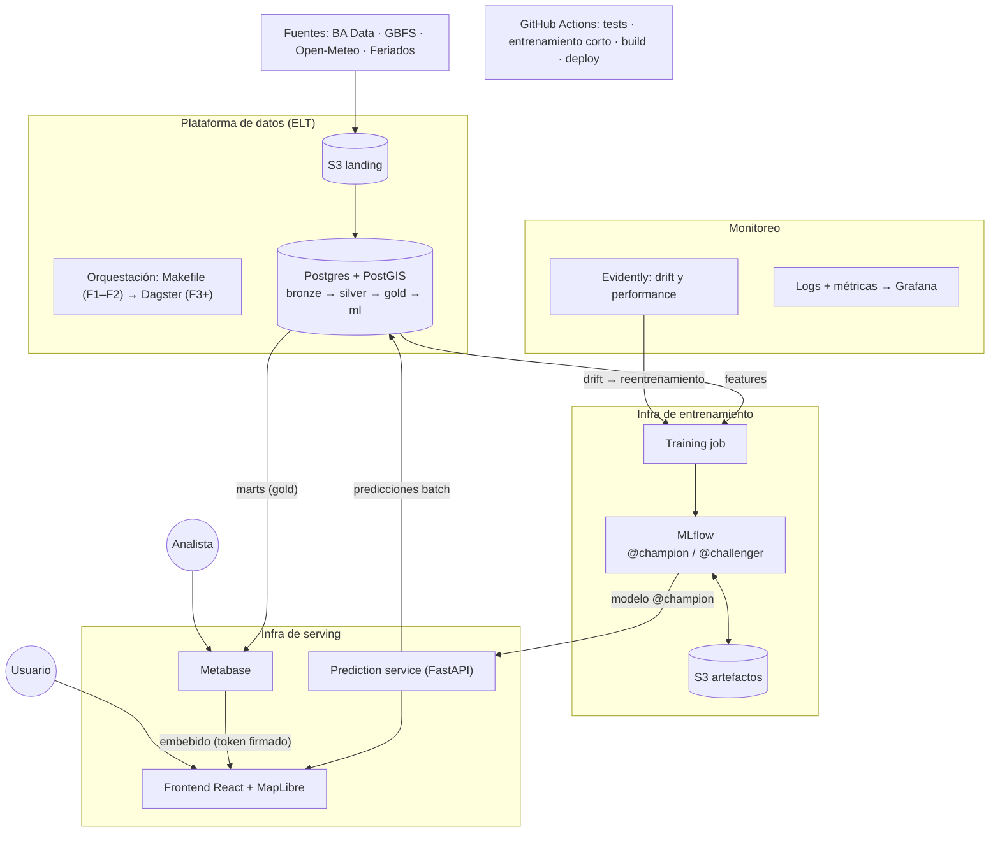

# 🧭 Plan de ba-ecobici

> Plan vivo: fija el rumbo, no el detalle. Se revisa al arrancar cada fase.

## Contexto

La idea nace de una pregunta cotidiana: **¿voy y vuelvo del trabajo en bici?** ¿Habrá una Ecobici en la estación cuando salga de casa a la mañana? ¿Habrá lugar para dejarla al llegar? ¿Y a la vuelta, a las 18, cuando todos salen del centro? Como usuario del sistema, conozco ese problema de primera mano. Como data engineer, lo puedo transformar en un producto de datos: entender cómo se mueve la ciudad en bici y predecir la disponibilidad de cada estación.

Al mismo tiempo, es una vitrina profesional para el camino **Data Engineer → AI Data Engineer**: ingeniería de software de punta a punta, data engineering (todo el histórico de Ecobici, near real time), data science (de una regresión lineal a modelos más complejos) y MLOps (registro de modelos, serving, monitoreo y reentrenamiento), construido de forma incremental, con issues y PRs chicos.

## Decisiones tomadas

### Gestión e idioma

- **Gestión:** solo GitHub. Requerimientos FR/NFR en [`requerimientos.md`](requerimientos.md); issues con `req:FR-XXX` y `type:feat|bug|chore|exp`; un milestone por fase.
- **Project único de GitHub** con todas las issues: tablero por estado, tabla por fase y roadmap; campos Fase, Tamaño y Área.
- **Forma de trabajo:** Definition of Done, `AGENTS.md` + `cerebro/`, TDD, code review antes de cada PR, Conventional Commits, merge con rebase y SemVer 0.x.
- **Idioma:** código en inglés (nombres, comentarios, esquemas y columnas de silver y gold); todo lo demás en español rioplatense (docs, issues, PRs, commits, ADRs).

### Datos

- **ELT + medallion:** `landing` (object storage S3, archivos crudos inmutables) → `bronze` (Postgres TEXT, con archivo y fila de origen) → `silver` (tipado, `*_rejected` con motivo, reconciliación bronze = silver + rechazados) → `gold` (estrella, agregados y marts) → `ml`.
- **Calidad de datos:** ingesta idempotente por hash SHA-256 del archivo, mapeo de columnas por año para absorber cambios de esquema, tests de dbt (unicidad, relaciones, rangos, reconciliaciones), profiling antes de modelar.
- **Postgres 16 + PostGIS (+ h3-pg):** comunas, barrios, celdas H3 y distancias. Roles separados: `etl` escribe y `bi_reader` solo lee `gold`.
- **Object storage S3-compatible:** guarda la landing y los artefactos de MLflow. Se elige con un ADR en F0 (MinIO dejó de publicar imágenes de la edición community en 2025, a verificar; alternativas: Garage, SeaweedFS). El código habla protocolo S3: en la nube pasa a S3 sin cambios.
- **Orden de los datos:** primero todo el histórico 2010–2026 (batch); después la carga incremental y el near real time (GBFS).
- **Rendimiento:** `fct_trips` particionada por mes, índices BRIN y GiST, agregados precalculados; medido con `EXPLAIN ANALYZE` antes y después.

### Herramientas

- **Orquestación progresiva:** F1–F2 con Makefile y un contenedor one-shot. Dagster entra en F3, cuando aparecen las cargas periódicas.
- **Metabase como código:** `provision.py` idempotente por API REST (admin, conexión, colecciones, preguntas, dashboards y clave de embedding).
- **Frontend:** Metabase desde F1. Después React + Vite + TS con dashboards embebidos de forma estática (token firmado por FastAPI) y mapas propios con MapLibre.
- **Registro de modelos:** alias de MLflow `@champion` (el modelo en producción, que la API carga por alias) y `@challenger` (el candidato nuevo). El challenger reemplaza al champion solo si lo supera en la misma validación. Rollback: se mueve el alias.
- **Imágenes livianas:** alpine para Postgres/PostGIS, nginx o Caddy y el build de Node; `python:3.13-slim` + uv multi-stage para Python. Usuarios non-root y tamaño medido en CI.
- **DuckDB:** fuera por ahora. Entra con un ADR solo si el perfilado, la carga o las features se vuelven lentos, con números medidos.
- **Deploy:** se analiza al llegar a esa fase, con un ADR que compare AWS EC2 + S3, AWS gestionado y un VPS.

## Arquitectura

- Una instancia de Postgres con bases separadas (`warehouse`, `dagster`, `mlflow`, `metabase`) y un object storage con buckets `landing` y `mlflow`.
- **Serving batch:** las predicciones se calculan cada hora y se guardan en `ml`; la API solo las lee.
- **Evidently y Grafana en lugar de ELK:** menos RAM, y el drift dispara el reentrenamiento.

## Fases

| Fase | Entrega | Qué se ve al final |
|---|---|---|
| F0 Fundaciones | Repo, Project, forma de trabajo, requerimientos, Makefile, pre-commit, CI, compose con PostGIS + object storage + Metabase, ADR de object storage | `make up` levanta todo |
| F1 Histórico 2010–2026 | Profiling de todos los años, landing → medallion, cambios de esquema, identidad de estación en el tiempo (SCD2), comunas, particionado, `provision.py` | **Primer dashboard en Metabase** con todo el histórico |
| F2 Geo e insights | Barrios, H3, flujos pendulares, origen-destino por franja, desbalance, cohortes, clustering de estaciones | Historias de movilidad en Metabase |
| F3 Orquestación e incremental | Dagster (lo del Makefile pasa a assets), carga mensual, frescura de los datos, alertas | Pipeline programado |
| F4 Near real time | Credenciales o feed GBFS; snapshots cada 5 min → landing → gold | Disponibilidad actual en Metabase |
| F5 API + frontend React | FastAPI + React con Metabase embebido + mapas con MapLibre | **App propia** |
| F6 Fundamentos de DS | Clima, feriados, backtesting, baselines, regresión lineal y de Poisson, MLflow | Reporte comparativo de modelos |
| F7 Serving + modelo avanzado | Predicciones en la API y el frontend; LightGBM; champion/challenger | Promoción automática |
| F8 Monitoreo | Evidently, reentrenamiento por drift, observabilidad | Ciclo cerrado |
| F9 Deploy | ADR de deploy, Terraform, CD, backups | URL pública |

## Cómo trabajamos

- **Plan vivo:** al arrancar cada fase se revisa y se ajusta (alcance, orden, herramientas) antes de bajar sus issues.
- **Backlog progresivo:** solo la fase actual y la siguiente tienen issues detalladas; el resto queda como épicas.
- **Cada issue:** criterios y plan → TDD → code review → commit → PR → merge. PRs de hasta ~400 líneas.
- **Al cerrar cada fase:** release con tag `vX.Y.Z` y retrospectiva corta (qué aprendimos de los datos, qué cambia del plan).
